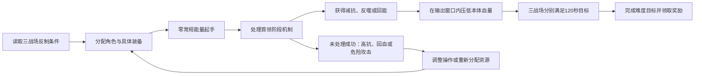

# 幽境危战：三战场能力分配与机制输出窗口

**《原神》战斗／系统策划作品集｜资料截止：2026年10月13日**

## 1. 分析范围与数据来源

正文只取单人难度5「无畏」与难度6「绝境」，三场景各自达标才算完成。难度4及以下、难度6的180秒挑战以及角色使用率统计不在范围内。数值取各战场主首领的初始基础血量，不含护盾、召唤物、回血、多命条与反噬抵扣；抗性按首领状态分别记录，百分比抗性与“增加多少个百分点”分开写。

| 项目 | 本文口径 |
|---|---|
| 版本范围 | 首期5.7（2025/06/25开启）至第12期7.1（2026/09/30开启） |
| 当前活动时间 | 2026/09/30 10:00—2026/11/03 03:59；爆发期已于2026/10/10 03:59结束 |
| 机制数值 | Alioth.wiki公开历史数据及其作者研究，属社区数值资料，本文未在游戏内实测 |
| 规则证据 | 优先官方公告与官方FAQ图文，社区规则页补充限时、等级等字段 |
| 推演 | 每处写明固定条件与公式，结果不当作实测DPS、通关率或玩家比例 |
| 设计分析 | 基于规则与参数推断体验与风险，不写成已经证实的留存、收入或满意度变化 |

日期依据[本期公告S01](https://www.taptap.cn/moment/853584114496833713)、[历史表C01](https://wiki.biligame.com/ys/幽境危战/5.X、6.X)与[7.X历史表C02](https://wiki.biligame.com/ys/幽境危战/7.X)。6.0—6.7在本文中依次对应「月之一」—「月之八」，方便与数值资料库对齐；资料库部分历史时间字段年份有误，图表已按上述来源校正。

## 2. 常驻系统：一轮挑战包含哪些决策

### 2.1 规则与难度5、6的差异

| 模块 | 难度5「无畏」 | 难度6「绝境」 | 战斗中的实际约束 | 来源 |
|---|---|---|---|---|
| 目标 | 三战场全部完成 | 三战场全部完成 | 某场提前完成不能替代另一场达标 | S01 |
| 首领等级 | 105 | 110 | 血量须逐首领读取；等级差亦会影响常规伤害结算 | S04、S05 |
| 单场限时 | 120秒 | 120秒 | 每场有独立时间门槛，不能只看三个首领的平均伤害要求 | S04、S07实机图 |
| 角色分配 | 出战角色不可跨场重复 | 出战角色不可跨场重复 | 三队最多占用12个角色位，通用辅助也须分配 | S02 |
| 装备分配 | 已用武器、圣遗物锁定 | 已用武器、圣遗物锁定 | 同一件装备不能转给后场；装备冲突会涉及挑战记录重置 | S02 |
| 起手资源 | 常规元素能量清空 | 常规元素能量清空 | 需安排战技产球、充能与爆发启动顺序 | S04、S06 |
| 赋光增益 | 入选角色生命上限、攻击力、防御力提升20% | 无该增益 | 同样的队伍与装备在两档中的实际能力不同 | S01、S02 |
| 档位目标奖励 | 启圣之尘等养成奖励 | 武器幻化等奖励 | 两档的挑战投入对应不同目标；对应奖励要求单人成功 | S02、S03、S04 |

表中“同一件装备”指具体装备实例，玩家手上的多份同名武器或同套圣遗物是不同资源。官方FAQ脚注写明：使用其他战场已用过的装备时，要保存该次记录就需要重置冲突记录，可见装备与战绩相互约束。常见误读是把这条规则扩大成“任何退出、失败或重试都会清空整轮”，本文按FAQ原文理解。[官方FAQ S02](https://www.taptap.cn/moment/686885144702748160)

“零常规元素能量”也不等于所有特殊资源都按同一规则处理。战意、蛇之狡谋等要按角色和首领的明确说明读取；例如水形幻人的特定阶段会直接恢复这类启动资源，见第4节。[首期机制H01](https://alioth.wiki/gi/stygian?id=1)

### 2.2 从配队到战斗结果的连接



首期可以用一个具体分配问题说明战前决策：水形幻人的半幻人可以用冻结处理，统御械需要持续冰伤压制，而熔岩辉龙像在推进机制时受到水冰伤害会回退。如果账号只有一套成熟的冰伤核心，必须决定把它完整保留给统御械，还是拆出其中的冰功能位去帮水形幻人；后者同时改变两场的输出与机制能力。[H01](https://alioth.wiki/gi/stygian?id=1)

| 分配路线 | 固定起点 | 能获得的能力 | 需要承担的代价 |
|---|---|---|---|
| 冰核心完整保留给统御械 | 同一账号、同一批装备、同样的三场目标 | 保持持续冰伤与低抗阶段的输出配置；水形幻人另用其他元素清半幻人 | 水形幻人队需承担分散目标的处理成本 |
| 拆出冰功能位给水形幻人 | 同上 | 用冻结快速处理中止吸收的条件 | 统御械队需验证剩余冰伤频率与输出是否仍足够 |
| 将更多辅助投入熔岩辉龙像 | 同上 | 强化其阶段推进或瘫痪后的输出 | 被挪走的通用辅助不能继续服务另外两场 |

上面只是能力分配的示例，不承诺任何账号或阵容能通关。真要比较路线，先把装备与账号资源固定下来，再逐场记录机制成功率、启动时间和伤害窗口；靠临时加角色命座让某条路线看起来更优，没有比较价值。

## 3. 从首期到当前：血量与机制环境的全部轮换

### 3.1 基础血量趋势


图1单位为百万生命值，数据来自Alioth历史页H01—H12。36个战场的整数血量逐场加总后与其历史索引一致，这验的是资料内部自洽，不等于实机测得的血量。

按同一口径，难度5从首期的**2095.55万**增至当前的**3152.27万，增幅50.43%**；难度6从**4302.28万**增至**6932.12万，增幅61.13%**，算法是“当前合计÷首期合计−1”。[H01](https://alioth.wiki/gi/stygian?id=1)、[H12](https://alioth.wiki/gi/stygian?id=12)

曲线中间有明显回落：第6期到第8期，难度6从5489.65万降到4497.35万，第9期又升到6543.29万。所以能说的是首尾基础血量抬高了，中间并非每期单调上涨。同期N6/N5总血量倍率约1.82—2.20倍，逐首领的差距更大，最低是约1.63倍的皮皮潘偶像，最高是约2.85倍的构型械，N6并没有套用统一的血量翻倍系数。[H02](https://alioth.wiki/gi/stygian?id=2)、[H06](https://alioth.wiki/gi/stygian?id=6)、[H08](https://alioth.wiki/gi/stygian?id=8)、[H09](https://alioth.wiki/gi/stygian?id=9)、[H10](https://alioth.wiki/gi/stygian?id=10)

**曲线上的低点要连机制一起读。**第4期执灯人的初始生命条只有N5约330.72万、N6约810.90万，但耗尽后还有狂猎阶段，要在特定状态下削减生命上限，召唤物没处理干净还会回复上限。初始血量小，不等于这一场的伤害任务最轻。[H04](https://alioth.wiki/gi/stygian?id=4)

举个计算例子：假设狂猎阶段起始生命上限就等于初始血量H，有效攻击全部落在可削减上限的状态内，并忽略回血、召唤物与其他结算差异，两阶段的名义伤害任务就是`H + H/k`。资料给出的满辉／非满辉系数k为0.90／0.65，N6对应约1711.91万／2058.45万。这个式子说明的是多阶段生命任务会怎样改变“看初始血量下判断”这件事，不是通关所需总伤害。[H04，规则推演](https://alioth.wiki/gi/stygian?id=4)

### 3.2 全部12期的逐战场总览


图2每格对应一个实际战场，血量单位为万，格内机制文字来自H01—H12的归纳，写的是明确的反制条件与结果。36个战场涉及28个不同的强化首领ID，其中8个战场重复出现，仍要放回当期三队分配环境里比较。

轮换里能看出四类环境变化：

| 时间段 | 可观察到的关卡条件 | 与前后轮换比较时要记录的能力 |
|---|---|---|
| 首期5.7 | 火伤推进形态、冰伤压制动量、半幻人处理并行存在 | 元素命中频率、阶段顺序、三队功能位分配 |
| 5.8至月之二 | 夜魂破罩优待、感电／月感电优待、绽放系种子转化、月曜解晦隐与免疫管理 | 普通攻击次数与特定体系效率的差值；哪些反制可由通用功能完成 |
| 月之三至月之七 | 牵引风涡、低重力下落、生命之契、满血破茧、孢子群、扩散型护罩、元素记录 | 范围覆盖、聚怪、治疗、空中命中、输出节奏与生存预算 |
| 月之八至7.1 | 星超导／星烁反制、屏障与元素护罩转换、风球处理、首次锁血强制冰棺 | 新反应触发能力、替代路线的时间成本、强制机制能否绕过 |

表里归纳的是**出现过的规则条件**，不是玩家配队或角色使用率的统计。逐场的首领、期次与血量都能在图2和[逐战场数据表](C:/Users/53656/Desktop/cx原神产品运营/作品/作品集F_幽境危战战斗系统拆解/数据/历期战场数据表.md)里查到。

## 4. 代表案例一：首期如何把元素功能变为阶段决策

### 4.1 三场的数值与反制

| 首领 | N5 / N6基础血量（万） | 高压状态 | 反制动作与状态结果 |
|---|---:|---|---|
| 水形幻人 | 765.88 / 1709.56 | 吸收阶段全抗210%；成功吸收半幻人后回血并强化 | 消灭或冻结两个半幻人以阻止吸收；蓄力时破除约8.85%本体血量的盾以中断危险攻击 |
| 熔岩辉龙像 | 569.06 / 1118.39 | 岩形态全抗200%；熔焰形态火抗仍200%、其他45% | 火伤推进形态与反噬；最终瘫痪时全抗降至10%；水冰会使推进回退 |
| 统御械 | 760.60 / 1474.33 | 开场全抗270%；持续旋转并积累动量 | 持续冰伤压制后停转，其他抗性30%、冰抗−30%；首次停转返还额外能量 |

数值与机制来自[H01](https://alioth.wiki/gi/stygian?id=1)，定性路径及主要抗性用[首期攻略S06](https://www.taptap.cn/moment/686932800439323373)交叉核对。该攻略是社区产出，其中配队成本与玩家体感的概括只是作者看法，本文没有采用。

水形幻人的破盾阶段同时重置技能冷却、恢复爆发启动资源。以N6计算，盾量约`1709.56万×8.85%=151.30万`，破盾还会让本体损失相应生命值。玩家面对的是一次明确的阶段伤害检查，而系统在检查开始时补偿了启动资源，“刚才技能是不是已经用完了”就不构成同样的资源障碍。[H01](https://alioth.wiki/gi/stygian?id=1)

熔岩辉龙像把元素的作用直接绑在阶段上：火伤先承担推进功能，进入瘫痪后才有低抗输出窗口，水冰伤害在推进阶段还可能撤销进度。攻击安排要按“命中条件→状态变化→下一阶段收益”走，不能只按单次倍率排序。

### 4.2 统御械：抗性前伤害相同，机制处理能改变多少输出

用KQM研究库的常规抗性乘区计算，令抗性R使用小数表示：

```text
R < 0：       抗性乘区 = 1 − R/2
0 ≤ R < 0.75：抗性乘区 = 1 − R
R ≥ 0.75：    抗性乘区 = 1 / (4R + 1)
```

公式来源：[S05，Enemy Resistance](https://library.keqingmains.com/combat-mechanics/damage/damage-formula#enemy-resistance)。固定其他伤害条件及抗性前伤害为10,000点，不计队伍减抗，结果如下。


270%抗性的乘区约0.08475，停转后的冰抗−30%对应1.15，相同抗性前冰伤下后者约为前者的**13.57倍**；其他元素在停转后的30%抗性对应0.70，约为开场的**8.26倍**。这是条件固定下的抗性收益，没有算进完成反制所耗的时间，也不能直接当成整场DPS增长。[H01](https://alioth.wiki/gi/stygian?id=1)、[H12](https://alioth.wiki/gi/stygian?id=12)、[S05](https://library.keqingmains.com/combat-mechanics/damage/damage-formula#enemy-resistance)

| 过程节点 | 起始信息 | 可行动作及成本 | 状态变化与后续收益 |
|---|---|---|---|
| 开场 | 旋转、高抗、常规能量为零 | 用战技启动持续冰伤；投入功能位和操作时间 | 液流动量逐渐被压低 |
| 首次停转 | 冰伤已满足压制条件 | 接取能量并安排辅助与输出顺序 | 低抗窗口形成；额外晶球补偿启动资源 |
| 窗口输出 | 冰抗−30%、其他30% | 保持冰伤压制，同时集中主要伤害 | 使更多伤害落在较高收益状态 |
| 另一条形态路线 | 场上角色持续处于夜魂状态 | 触发应战形态并处理追踪攻击 | 抗性降至110%，随后仍可由冰伤继续压制；生存与机动成本不同 |

资料研究给出的冰伤平衡频率是约0.6秒一次，首次停转的额外晶球对应36点能量。这两个是作者研究参数，实战里还要验证命中、持续覆盖和能量接取，队伍里带一个冰角色并不自动等于满足频率。[H12](https://alioth.wiki/gi/stygian?id=12)

**一个容易算错的整数：**熔岩辉龙像的两次反噬各按当时剩余生命值的15%计算，且各有150万上限。两次触发之间没有其他伤害时，N5未触及上限的总扣血为`1−0.85²=27.75%`，不是30%；N6首次触及上限，第二次按扣除150万后的当前生命值计算，总扣血约295.26万、占初始血量26.40%。触发前的其他伤害还会继续改变这个结果。[H01，计算推演](https://alioth.wiki/gi/stygian?id=1)

## 5. 代表案例二：月之四如何形成盾阶段的替代路线

选第6期深黯魇语之主。其N5／N6基础血量为1243.78万／2365.81万；深黯护盾为本体血量的45%，月曜反应对盾伤害是通常值的3倍，四个召唤物各有本体18%的血量，击败一个可额外削减25%护盾。破盾后本体损失20%生命值，获得16秒虚弱且全抗−60%。[H06](https://alioth.wiki/gi/stygian?id=6)

### 5.1 固定同一盾阶段，比较两条路线

下面只比较盾阶段的任务量，难度、装备与攻击能力固定，不包含之后的本体输出、生存、跑位、攻击范围以及同时命中本体的额外收益。表中“基准盾伤害”指享受首领特殊3倍增幅之前、其他结算条件相同的伤害。

| 项目 | N5 | N6 | 公式／条件 |
|---|---:|---:|---|
| 护盾血量 | 559.70万 | 1064.61万 | 0.45H |
| 全用月曜伤害破盾的基准伤害量 | 186.57万 | 354.87万 | 0.45H÷3=0.15H |
| 一个召唤物血量 | 223.88万 | 425.85万 | 0.18H |
| 四个召唤物血量合计 | 895.52万 | 1703.38万 | 4×0.18H=0.72H |
| 破盾后的本体直接扣血 | 248.76万 | 473.16万 | 0.20H |

计算所据：[H06](https://alioth.wiki/gi/stygian?id=6)。H为对应难度主首领初始血量。

在“每个目标每秒承受基准伤害D”的简化条件下，月曜直打护盾需约`0.15H/D`，逐一击败四个召唤物需约`0.72H/D`；如果四个召唤物能完全重叠并被同一范围攻击持续覆盖，理想时间下界接近`0.18H/D`。后面这个结果依赖位置、聚怪与范围命中，不能把“四只怪血量相加”直接当成范围队伍的耗时。

### 5.2 状态与操作顺序

| 节点 | 玩家可见目标 | 路线A：主要攻击护盾 | 路线B：处理召唤物 |
|---|---|---|---|
| 生成护盾 | 盾条与四个额外目标出现 | 启动月曜伤害，利用特殊倍率；首次相应伤害还会产生额外晶球 | 安排聚怪或范围覆盖，优先把攻击落在多个有效目标上 |
| 盾阶段进行中 | 盾量下降与召唤物血量变化 | 检查是否需要补能、躲避或转火 | 每击败一只减少四分之一护盾；若已对盾输出，可采用混合路线 |
| 破盾瞬间 | 敌人虚弱并出现直接扣血 | 将剩余技能接到16秒低抗窗口 | 收束多目标阶段，将主要输出转回本体 |
| 窗口结束 | 虚弱结束 | 恢复下一轮循环与反制准备 | 同左；前一轮的聚怪成本不能自动抵消下一轮资源需求 |

这个例子支持两个判断：特定反应能直接压低盾阶段的任务量；通用范围攻击与聚怪同样有明确的机制贡献。但两条路线存在，不代表它们对所有账号等价，替代路线值不值得走，要用实际位置、攻击覆盖和完整三队资源重新比。

同一期的火刃突击队员也偏向感电／月感电破再生盾，铁甲熔火帝皇则要处理火角与扈从。把最强的反应核心配给第一场之后，后两场仍要留出足够的反应与水元素能力，这正是“本场最优路线”和“三场都能完成”之间的差别。[H06](https://alioth.wiki/gi/stygian?id=6)

## 6. 代表案例三：当前期的强制交互与护盾转换

当前第12期的三场分别是矮灵雕刻师、统御械与游雪的护刃，对应N6初始血量3270.65万、1474.33万、2187.15万。仅用基础血量除以120秒，得到约27.26万、12.29万、18.23万点／秒的平均血量削减量。这个数字忽略全部阶段机制，只能当基准，用来推荐阵容或判断配置门槛都不合适。[H12](https://alioth.wiki/gi/stygian?id=12)

### 6.1 雕刻师：反制同时改变进攻与防御压力

雕刻师初始全抗90%。在雕刻期间施加辉映·星烁可以让雕像转化，阻止它变成攻击炮台，随后产生反噬并降低首领抗性，风抗还有额外降低。一次正确反制同时影响敌人的持续攻击、生命值和后续输出收益。[H12](https://alioth.wiki/gi/stygian?id=12)

雕像的定量时间轴这里不算。Alioth研究列出的层数与首领特性中的三层上限，同另一篇攻略的“双雕像／单雕像”说法之间还差一层计量单位对齐，差异和处理见第8节。跳过这一步不影响反制结构的分析。

### 6.2 游雪的护刃：两条路线改变的是成本形态

游雪的护刃首次在约80%生命值处触发锁血与冰棺。Alioth研究进一步区分了81%的触发值与80%的最低生命限制，本文只取其“首次不能单靠爆发绕过冰棺”这一状态关系，不去推导毫秒级伤害判定。冰棺元素护罩为42单位，未在20秒内破除会回血；破除后本体受反噬，进入10秒虚弱且全抗−40%，还可能再出现第二次冰棺。[H12](https://alioth.wiki/gi/stygian?id=12)、[S07](https://www.taptap.cn/moment/854498910939383038)

| 路线 | 需要完成的任务 | 获得的结果 | 成本与边界 |
|---|---|---|---|
| 元素反应破罩 | 以有效反应耗尽42单位冰元素护罩 | 基础反噬为本体最大血量的10%，随后进入低抗窗口 | 依赖有效附着、反应种类与操作覆盖；伤害高不自动等于元素消耗快 |
| 星烁转换后破盾 | 将剩余元素护罩转为至多15%本体血量的屏障，再造成足量伤害 | 在基础反噬之外增加至多9%本体血量的额外反噬 | 需要转换能力和屏障伤害；屏障量与额外反噬均按转换时剩余比例缩放 |

若N6冰棺在完整护罩时转换，屏障上限约`2187.15万×15%=328.07万`，额外反噬上限约`2187.15万×9%=196.84万`，加上基础10%后合计反噬上限约415.56万。先用元素反应消耗一部分护罩再转换的话，完整屏障和完整额外反噬这两个上限就不能同时成立。[H12，计算推演](https://alioth.wiki/gi/stygian?id=12)

从状态流程看，新路线把“元素量消耗任务”换成了“伤害量任务”。反噬收益高不代表所有队伍都更快，要比的是转换条件、盾阶段耗时、技能能不能留给10秒窗口，以及其他两队被占用了哪些角色。首轮锁血又让这个比较变成必须处理的交互，而不是可以完全跳过的可选收益。

## 7. 设计分析：目标玩家、核心体验、优缺点与运营意义

### 7.1 目标玩家：同一玩法承接两种高难目标

| 目标玩家 | 参与目标与已有能力 | 玩法要求其做什么 | 可能产生的主要摩擦 |
|---|---|---|---|
| 难度5达标型玩家 | 希望取得养成奖励；已有多队培养基础，愿意学习首领规则 | 把角色库转成三组功能完整的队伍；利用机制收益与赋光增益满足各场限时 | 账号总战力足够但缺某种反制能力；装备与通用辅助分配冲突 |
| 从难度5进阶到6的玩家 | 希望完成更高档位；有相对成熟的输出与生存配置 | 在失去赋光增益、首领血量提高的条件下重新验证循环与机制效率 | 用难度5的成功流程估算难度6，低估启动、伤害与生存差异 |
| 难度6完成型玩家 | 将完整通关作为账号养成与操作能力的检验；接受反复练习 | 三场分别处理机制、控制失败点，并使主要伤害落入有效窗口 | 改善单场后破坏其他队伍；反制已成功但仍不能判断继续投入是否有效 |

N6同一期总血量约为N5的1.82—2.20倍，但升级不只是血量：还有等级变化与赋光增益失效。20%的属性增益也不能简单当成20%的整队最终伤害，不同角色吃的属性不同，现有属性构成和机制贡献也各不相同。判断难度分层，用完整队伍在该档位下的阶段任务更靠谱，套一句“配置翻倍”概括不了。

### 7.2 核心体验：把机制处理兑换成输出窗口

核心体验可以概括成一句话：**理解首领提出的能力条件，完成反制，拿到可利用的输出窗口，再把三场的成功组合起来。**

这条链条分三层。战前，角色与装备锁定决定每种能力放在哪一场；战中，命中频率、元素反应、转火、治疗与技能顺序改变首领状态；结果阶段，减抗、反噬和回能把成功反制转成可见的伤害推进。统御械那13.57倍的固定条件抗性收益说明，机制处理对了战斗价值可以很大；月之四的两条盾路线则说明，这份价值还取决于范围能力和账号资源。

链条成立的前提是：玩家能识别触发条件与状态结果，能看见反制收益，也能区分“没有完成机制”“完成后错过窗口”“窗口利用充分但伤害不足”。如果这三件事在界面上都只表现为同一种超时，学习过程就会变成没有方向的重试。

### 7.3 优点及其成立条件

| 设计优点 | 前文证据 | 对战斗体验的作用 | 成立条件 |
|---|---|---|---|
| 机制成功有明确收益 | 统御械减抗与回能；深黯破盾反噬；冰棺破除后虚弱 | 给操作与理解提供可见回报，让技能顺序值得调整 | 收益需能被玩家观察，并与触发动作建立联系 |
| 账号广度进入真实决策 | 三队角色及装备锁定；首期冰功能位争夺 | 通用辅助、治疗、范围和功能角色都有分配价值 | 三场的能力需求须有差异，且账号有可实施的配置选择 |
| 同一规则允许不同能力参与 | 深黯直打盾／击败召唤物；游雪元素破罩／转换后打血量盾 | 不同输出形态可以寻找适合自身的路径 | 替代路线需在合理资源和时间范围内可完成，而非仅在规则文字上存在 |
| 轮换能改变操作任务 | 下落攻击、治疗至满血、孢子群、元素记录等条件 | 让范围、治疗、机动与资源管理进入高难挑战 | 玩家仍能读懂哪些已有经验可以迁移 |
| 难度5与6提供不同目标 | 养成目标与外观目标；赋光增益差异 | 允许玩家按目标选择投入深度 | 达标目标与额外投入须清晰，奖励信息不造成误判 |

### 7.4 缺点与主要设计风险

| 问题 | 具体证据与触发条件 | 可能影响 | 需要怎样判断 |
|---|---|---|---|
| 特定体系收益差值可能压缩选择 | 月曜对深黯盾伤害×3；夜魂破罩优待；星烁转换与打断 | 不具备对应触发能力的账号，替代路线成本明显提高，可能把机制题体验为角色持有条件 | 同装备预算比较替代路线的盾阶段耗时、完整通关能力与其他队伍损失 |
| 血量增长与强制交互叠加 | 当前N6基础血量较首期提高61.13%；游雪首次锁血冰棺 | 单纯增加伤害不能跳过所有任务；若剩余输出要求仍高，玩家可能同时承受机制与养成压力 | 分开测量机制完成时间、窗口利用和剩余血量，避免把失败全归因于血量 |
| 规则迁移存在反例 | 首期水形鼓励冻结半幻人，熔岩在推进时受水冰会回退；龙兽高难核心封闭 | 既有大世界经验或另一场打法会产生错误迁移 | 玩家在首次失败后能否说清阶段条件，并在下一次主动调整 |
| 失败信息可能不足以指导重试 | 高抗、盾恢复、元素免疫、命中频率不足都可能最终表现为超时 | 玩家无法判断下一次应该改操作、配置还是目标 | 记录玩家解释、下一次动作及结果，确认这类情况有多普遍 |
| 三场耦合提高局部优化成本 | 通用辅助与装备冲突会影响已完成的其他战场 | 单场改善不保证整轮改善，反复改配装可能增加操作负担 | 同时核算三场结果与装备调整时间；不能只看最难的一场 |

这些风险各有边界。比如反应优待可以让新能力在战斗里被看见，只要通用路线仍有明确的可行区间，它就构成有意义的取舍；反过来，如果替代路线在目标玩家的账号预算内几乎走不通，规则上写了几条路线也支撑不起实际选择。

### 7.5 产品／运营视角：轮换内容检验哪些长期能力

从首期到当前，火伤推进和冰伤压制先建立了三场的功能差异，之后陆续加入夜魂、月曜以及星烁这类带特定触发条件的能力。这份轮换记录说明幽境危战能为版本战斗系统提供高难应用场景，也会促使玩家重新评估角色库里的功能组合；至于这种评估有没有真的转化成培养与参与行为，得看行为数据。

重复首领也会因为同场资源竞争而改变选择。统御械出现在第1、7、12期，反制条件有延续性，但另外两场的任务不同，同一个冰伤团队在整轮里的机会成本就跟着变。这样的内容安排既提供可复用的学习经验，也让每期的配队题继续变化。36战场／28个强化首领ID只说明公开内容的复用结构，用它推算开发成本下降并不成立。

赋光在系统上是一种联动：难度6的通关结果参与生成有增益的角色名单，难度5玩家用入选角色可获得属性帮助。它可能降低部分配置压力，也给玩家提供选择线索。[S02](https://www.taptap.cn/moment/686885144702748160)

评估这类玩法，至少要同时看“本期是否被尝试”“反制是否学会”“目标是否被完成”“下期是否继续参与”。只看一次通关人数，环境适配、账号成长、练习效果和参与人群变化混在一起，也证明不了某个版本角色的付费或留存效果。

### 7.6 优先验证方案：让失败诊断能够指向下一次操作

**拟案假设：**部分难度5进阶玩家的重复失败来自阶段条件理解错误。先测一张“战后阶段复盘卡”，首领与数值都不动，看诊断反馈能不能改善下一次选择。

| 项目 | 具体设计／验证方法 |
|---|---|
| 测试对象 | 已有三队基础、尝试难度5或进阶6的玩家；按首领熟悉度和现有反制能力分组 |
| 触发 | 失败后或主动打开战斗记录时展示；同一战斗不反复弹出相同提示 |
| 首个实施例 | 统御械：显示进入低抗状态的次数、首次进入时间、处于高抗／低抗状态的时长；不预设必须使用某个角色 |
| 信息反馈 | 根据已发生的状态事件，区分“未形成低抗窗口”“形成后利用不足”“主要时间已处于窗口但仍未完成”；伤害不一定是唯一原因 |
| 边界处理 | 尚未完整记录状态的战斗仅展示已记录事件，不输出确定失败归因；装备改变后重新比较当前配置；触发条件已达成时不继续提示其未达成 |
| 对照方法 | 相近账号与熟悉度随机分组，使用现有反馈或复盘卡；同一组内固定装备。若做同一玩家先后比较，需控制练习与顺序影响 |
| 主要观察 | 能否解释状态条件；下一次是否主动调整；下一次机制成功次数、首次成功时间及完整通关结果。分母分别为有效受试者与有效战斗次数 |
| 副作用观察 | 阅读耗时、提示误导、是否把流程误解为唯一配队、三场配置是否被不必要地重置 |
| 停止条件 | 现有反馈已能支持正确理解；复盘卡未改变下一次有效行动；或出现明显误归因与依赖提示，均不进入正式开发 |

这个方案还没有实验数据，它先回答“玩家知不知道下一次该改什么”，再决定要不要动首领、增益或提示，也不会预先设定一个通关率提升目标。

## 8. 来源、冲突处理与交付复核

### 8.1 来源表

| 编号 | 资料与发布者 | 日期／适用版本 | 支持内容与定位 |
|---|---|---|---|
| S01 | [本期活动公告，西风快报员](https://www.taptap.cn/moment/853584114496833713) | 2026/09/28；7.1 | 活动时间、三战场、六档、赋光增益失效、单人领奖；“活动说明” |
| S02 | [官方上线小贴士，西风快报员](https://www.taptap.cn/moment/686885144702748160) | 2025/06/25；5.7 | 角色与装备锁定、冲突记录、单人领奖、赋光规则；FAQ第二及第三张图，副本见资料/官方图文 |
| S03 | [官方玩法介绍，西风快报员](https://www.taptap.cn/moment/682956817386439654) | 修改于2025/06/15；5.7 | 新常驻玩法、档位与奖励、周期；官方介绍图文 |
| S04 | [幽境危战，BWIKI协作编辑](https://wiki.biligame.com/ys/幽境危战) | 访问2026/10/13 | 等级、限时与常规能量起手；“规则：难度和解锁条件”“角色使用与联机”。社区规则汇总 |
| S05 | [Damage Formula，KQM研究库](https://library.keqingmains.com/combat-mechanics/damage/damage-formula#enemy-resistance) | 访问2026/10/13 | 常规抗性乘区；Enemy Resistance。玩家研究资料 |
| S06 | [首期攻略，冻梨游研社](https://www.taptap.cn/moment/686932800439323373) | 2025/06/25；5.7 | 首期三首领的定性反制与抗性交叉核对。社区攻略，不作人群证据 |
| S07 | [7.1攻略，冻梨游研社](https://www.taptap.cn/moment/854498910939383038) | 2026/09/30；7.1 | 当前三首领、Lv110与120秒目标实机图、冰棺路线及抗性交叉核对 |
| S08 | [5.7开发者介绍，HoYoverse技术总监Zhenzhong Yi](https://blog.playstation.com/2025/06/06/genshin-impact-version-5-7-arrives-with-skirk-on-june-18/) | 2025/06/06；5.7前瞻 | 每版本三阶段新挑战、通过第五档解锁第六档；“Fun awaits”末段。当前多人资格仍按S01 |
| C01 | [5.X、6.X历史表，BWIKI协作编辑](https://wiki.biligame.com/ys/幽境危战/5.X、6.X) | 页面更新2026/08/27 | 第1—10期的开放与结束日期、首领组合；不采用其角色名单 |
| C02 | [7.X历史表，BWIKI协作编辑](https://wiki.biligame.com/ys/幽境危战/7.X) | 页面更新2026/08/27 | 第11期挑战日期及组合；不采用其爆发期误写字段 |
| H01 | [第1期，Alioth.wiki](https://alioth.wiki/gi/stygian?id=1) | 5.7；2025/06/25起 | 水形幻人、熔岩辉龙像、统御械；Stats、RESShow、Tutorial、Buff |
| H02 | [第2期，Alioth.wiki](https://alioth.wiki/gi/stygian?id=2) | 5.8；2025/08/06起 | 摹结株、玳龟、皮皮潘；同上字段 |
| H03 | [第3期，Alioth.wiki](https://alioth.wiki/gi/stygian?id=3) | 月之一；2025/09/17起 | 龙兽、岩居蟹、火刃；同上字段 |
| H04 | [第4期，Alioth.wiki](https://alioth.wiki/gi/stygian?id=4) | 月之二；2025/10/29起 | 霜夜灵主、执灯人、霜役人；同上字段 |
| H05 | [第5期，Alioth.wiki](https://alioth.wiki/gi/stygian?id=5) | 月之三；2025/12/10起 | 浸礼者、暝视龙、场力装置；同上字段 |
| H06 | [第6期，Alioth.wiki](https://alioth.wiki/gi/stygian?id=6) | 月之四；2026/01/21起 | 深黯、火刃、熔火帝皇；同上字段 |
| H07 | [第7期，Alioth.wiki](https://alioth.wiki/gi/stygian?id=7) | 月之五；2026/03/04起 | 曼陀草、重拳鸭、统御械；同上字段 |
| H08 | [第8期，Alioth.wiki](https://alioth.wiki/gi/stygian?id=8) | 月之六；2026/04/15起 | 月守宫、摹结株、霜夜灵主；同上字段 |
| H09 | [第9期，Alioth.wiki](https://alioth.wiki/gi/stygian?id=9) | 月之七；2026/05/27起 | 凛狼、水形幻人、开眼者；同上字段 |
| H10 | [第10期，Alioth.wiki](https://alioth.wiki/gi/stygian?id=10) | 月之八；2026/07/08起 | 先驱阵列之影、深黯、构型械；同上字段 |
| H11 | [第11期，Alioth.wiki](https://alioth.wiki/gi/stygian?id=11) | 7.0；2026/08/19起 | 嵌合翼骏狮、风役人、重拳鸭；同上字段 |
| H12 | [第12期，Alioth.wiki](https://alioth.wiki/gi/stygian?id=12) | 7.1；2026/09/30起 | 雕刻师、统御械、游雪护刃；同上字段 |

H01—H12均于2026/10/13采集，公开HTML与对应数据副本放在资料目录，每个战场的数据对象定位已写进JSON。历史网页里的首领特性转录和作者“研究”参数是两类东西，不能整页都当官方数据看。

### 8.2 已处理的资料差异

| 差异 | 本文的处理 | 对结论的影响 |
|---|---|---|
| Alioth部分历史日期年份误写，BWIKI第11期爆发期亦有误写 | 第1—11期挑战日期采用C01、C02；当前采用S01；不使用错误的爆发期字段 | 不按错误年份排列时间轴，也不由固定间隔补造期次 |
| [Stygian.moe](https://www.stygian.moe/)将当前结束写为11/11 | 采用本期公告S01的11/03 | 当前活动状态与周期以官方公告为准 |
| 当前N6血量在两库间有细小差异 | 全序列统一使用Alioth历史口径；雕刻师与统御械的两库单体差异约0.83%、1.18% | 不将这些差值解释为设计调整；首尾趋势仍须以注明的数据源理解 |
| 雕刻师单雕像／双雕像扣血、研究层数与特性三层上限叙述需要对齐 | 定量分析只使用一致的初始90%抗性；不计算精确叠层伤害时间轴 | 保留“转化雕像同时减抗、扣血并避免炮台”的一致机制关系 |
| 游雪护刃研究区分81%触发与80%限值，攻略简写约80% | 用首次锁血与冰棺转换解释决策，不推导精确帧级判定 | 不影响两条反制路线的成本形态比较 |
| 熔岩瘫痪时间在资料中为16秒或约17秒 | 正文只使用瘫痪状态与抗性，不用这一秒差生成循环时间表 | 具体技能轴需另有相同期次实机记录才能精确验证 |

### 8.3 完成的复核

12个期次、每期3个战场、36组N5／N6血量都已逐场核对，加总与资料库历史索引一致；首尾增幅、难度倍率、盾阶段与反噬推演按公式复算过一遍。三张图在正文里按原尺寸显示并自带放大视图，同目录还有SVG可缩放。正文表格全部填的是实际规则、数据、分析条件或明确结论，没有留待补字段。

这次没有做实机测量，也没有玩家实验。报告能支撑的是规则拆解、资料口径下的数值比较和有条件的设计判断；目标玩家规模、真实失败分布、留存与商业结果，还需要另外的数据才能说。
